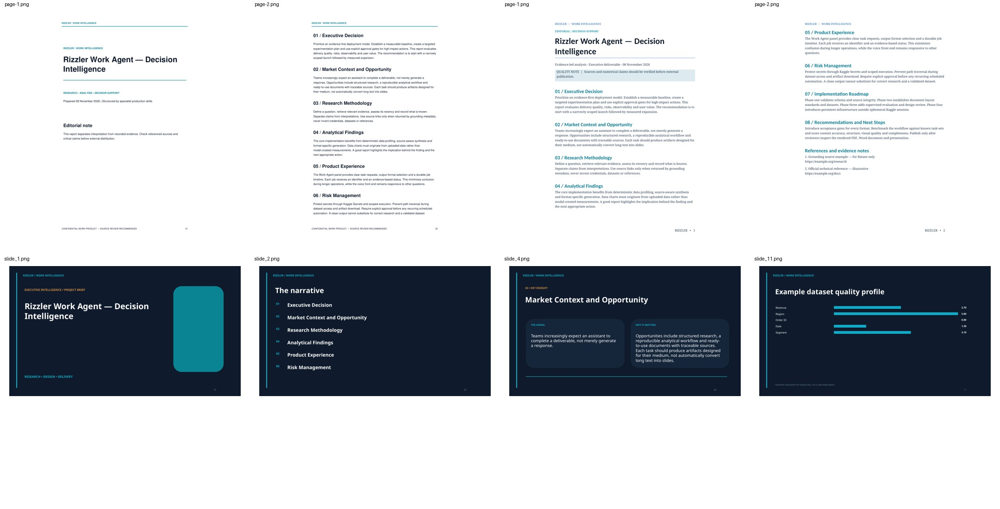
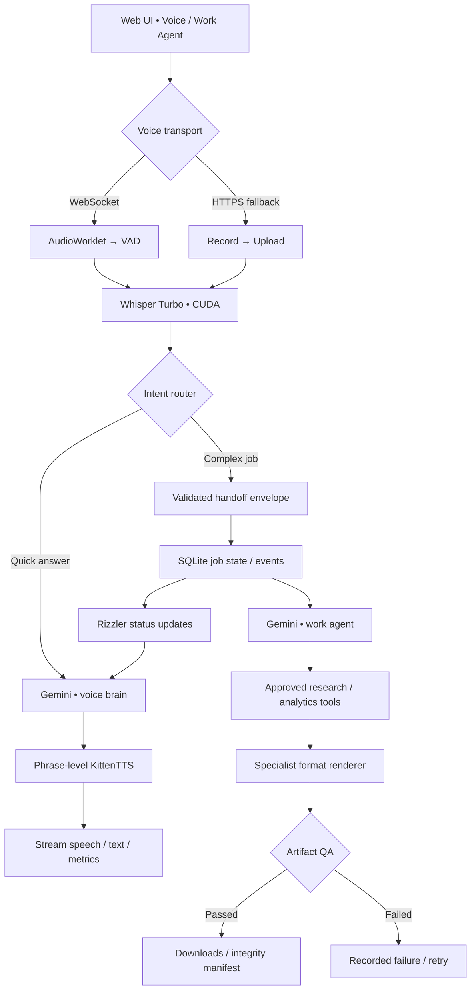

<div align="center">

# RIZZLER

### Real-time voice intelligence · Gemini-powered work agent · Specialist artifact studio

**A Kaggle GPU prototype with a continuous voice interface and a separate long-running research and deliverables engine.**

[Voice Pipeline](docs/voice-pipeline.md) · [Work Agent](docs/work-agent-architecture.md) · [Architecture](docs/architecture.md) · [Project Brief](docs/project-brief.md) · [Kaggle Quickstart](docs/kaggle-setup.md) · [17 Skills](docs/skills.md) · [Benchmarks](benchmarks/RESULTS.md) · [Security](SECURITY.md)

</div>

---

> **Release classification: showcase / research preview.** The notebook and offline contracts are testable; live Kaggle GPU, cloud-model and phone/browser microphone performance are **not currently certified**. GitHub Actions run static and CPU-only tests, not NVIDIA inference. Rizzler is not production-hardened for multi-tenant or confidential workloads.

## Product overview

Rizzler combines a responsive, speech-first interface with a **separately governed asynchronous Work Agent**. The main voice flow uses Whisper Turbo for recognition, Gemini for conversational responses, and KittenTTS for masculine speech. Requests requiring research, data analysis, presentation design or document creation are delegated to a second Gemini role, while Rizzler can continue answering questions and report job status from the persistent job ledger.

The notebook ships with a self-contained desktop/mobile browser UI, WebSocket streaming voice session transport, a reliable record-and-stop HTTPS fallback, structured progress events, interruption generation tokens and a 17-skill deliverables studio.

### At a glance

| Component | Implemented path | Status |
| --- | --- | --- |
| Speech to text | Whisper large-v3-turbo, CUDA CTranslate2 with PyTorch fallback | Notebook implementation; live Kaggle verification needed |
| Conversation | Gemini Flash-Lite, streamed text and bounded retries | Notebook implementation; model availability depends on account |
| Speech output | KittenTTS Nano ONNX, Bruno voice | Notebook implementation; voice quality subjective |
| Live session | AudioWorklet/WebSocket, VAD and interruption generations | Browser/server wiring; device testing needed |
| Heavy work | Second Gemini model, validated handoff, jobs/events in SQLite | Offline mocked-job tests from V9; live calls needed |
| Deliverables | PDF, Word, PPTX, Excel, HTML, CSV, JSON, Markdown, PNG, SVG, TXT, ZIP | Format-specific local renderers and structural checks |
| Automation | Gated recurring job proposals and job status reporting | Only while server runs; user approval required |
| CI | Notebook syntax/order, CPU contracts, secret guard, JS syntax, CodeQL | Automatable without keys or GPU |



<sub>Offline sample output layout. Illustration only; not a live Gemini research benchmark.</sub>

## Architecture



For the **full voice block diagram, sequence diagram, interruption state machine and timing boundaries**, see [Voice AI pipeline](docs/voice-pipeline.md). For **asynchronous orchestration and the artifact production flow**, see [Work Agent architecture](docs/work-agent-architecture.md). For a concise reviewer summary, see [Project brief](docs/project-brief.md). System limitations and production migration are documented in [architecture.md](docs/architecture.md).

## Getting started on Kaggle

1. Create a Kaggle notebook, enable **Internet** and an **NVIDIA GPU** (T4/P100 where supported).
2. In **Add-ons → Secrets**, add `GEMINI_API_KEY` and `RIZZLER_ACCESS_KEY` (at least 16 random characters). Enable them for this notebook.
3. Upload/import [`notebooks/Rizzler_V9_Kaggle_Gemini_Specialist_Skill_Studio.ipynb`](notebooks/Rizzler_V9_Kaggle_Gemini_Specialist_Skill_Studio.ipynb), then **Run All in cell order**. Do not replace Kaggle's installed PyTorch/CUDA with an AMD ROCm wheel.
4. Ensure real ASR, TTS and Gemini warmup cells pass before starting FastAPI. Check `/health` and `/api/auth` through your authenticated HTTPS preview.
5. Use **Start Session** for continuous capture or the **Gradio record-and-stop fallback** if WebSocket connectivity is blocked. Supply the same private `RIZZLER_ACCESS_KEY` to the UI.

See [full Kaggle setup](docs/kaggle-setup.md) for troubleshooting and [Hugging Face deployment roadmap](docs/deployment-roadmap.md). **Do not commit your Kaggle notebook with executed outputs.**

## Specialist capabilities

The Work Agent currently exposes **17 governed skills** with individual formatting and validation contracts. A generated report, slide deck, workbook and archive are *different production paths*, not merely copies of one chat response. Capabilities include source-grounded research, dataset profiling, multi-section PDF/DOCX, business presentations, spreadsheets, numerical charts, structured exports, integrity manifests, approval-based schedules and truthful spoken progress.

See [the complete specialist skill contracts](docs/skills.md) and [offline sample deliverables](examples/README.md). Factuality and visual polish still require human review for consequential work.

## Benchmarks: measured data, not aspirations

| Run | Metric | Observed | Evidence |
| --- | --- | --- | --- |
| Historical Gemini Flash-Lite, 20 warm calls | TTFT median / p95 | **1012.7 / 1136.0 ms** | Previously reported benchmark summary; raw samples not attached |
| Historical Gemini persistent client, 10 calls | TTFT median / p95 | **960.3 / 1076.3 ms** | Previously reported benchmark summary; different sample size |
| Legacy 2026-11-04 voice test, 1 failed turn | ASR / full failed turn | **5380.5 / 9248.4 ms** | Redacted event log in `benchmarks/data/` |
| **V9 live Kaggle voice E2E** | First audible sound, p50/p95 | **Not measured** | Requires instrumented Kaggle and real browser |

**The historical numbers are not V9 performance claims.** The 300 ms first-audio value in the notebook is a *stretch target*, not a measured result. See [results and reproducibility](benchmarks/RESULTS.md).

## Quality and verification

See the [full acceptance matrix](docs/quality.md) and [declared API routes](docs/api.md).


```bash
python scripts/validate_notebook.py
python -m unittest discover -s tests -v
python scripts/scan_secrets.py
node --check web/app.js
python scripts/validate_frontend.py
python scripts/build_frontend.py --check
python scripts/benchmark.py benchmarks/data/legacy_failed_turn.jsonl
```

These commands validate notebook syntax and ordering, a provider-independent state machine, handoff permissions, artifact completion checks, secret hygiene and frontend integration references. **They do not execute Whisper, Gemini, KittenTTS or a live WebSocket.** Hardware/device performance must be supplied separately.

## Repository layout

```text
notebooks/       Canonical standalone Kaggle GPU notebook
web/             Extracted offline-inspectable UI snapshot + JavaScript
src/rizzler/     Reusable testable contracts, security, state, metrics
scripts/         Static notebook checks, UI extraction, key scan, benchmark CLI
schemas/         Published Gemini Work Agent handoff contract and example
examples/        Synthetic offline example files and visual QA sample
tests/           Deterministic CPU-only unit tests and sample artifact structural checks
benchmarks/      Provenance-tagged historical metrics and repeatable protocol
docs/            Architecture, work agent skills, setup, security, roadmap
.github/         CI, CodeQL and contribution templates
```

The reusable Python modules in `src/rizzler/` are **hardening foundations**, not yet a fully extracted replacement for the notebook's in-cell runtime. Modular extraction is an explicit next milestone rather than a completed claim.

## Roadmap

Next: measurable Kaggle speech performance; hardened auth, quota and multi-tenant isolation; persistent queue and storage; unit/visual regression tests for all formats; packaged Hugging Face Docker Space; end-to-end GPU + browser CI on a self-hosted runner. [Full roadmap](docs/roadmap.md).

## Publishing to GitHub

See [repository publishing instructions](docs/publishing.md) for the existing GitHub App access prerequisite and safe push commands.

## License and attribution

Copyright © 2026 repository owner. **No open-source license has yet been selected**; GitHub's default copyright rules apply. The owner should choose a license intentionally before accepting distribution or external contributions. External model, library and SDK licenses remain their own.
