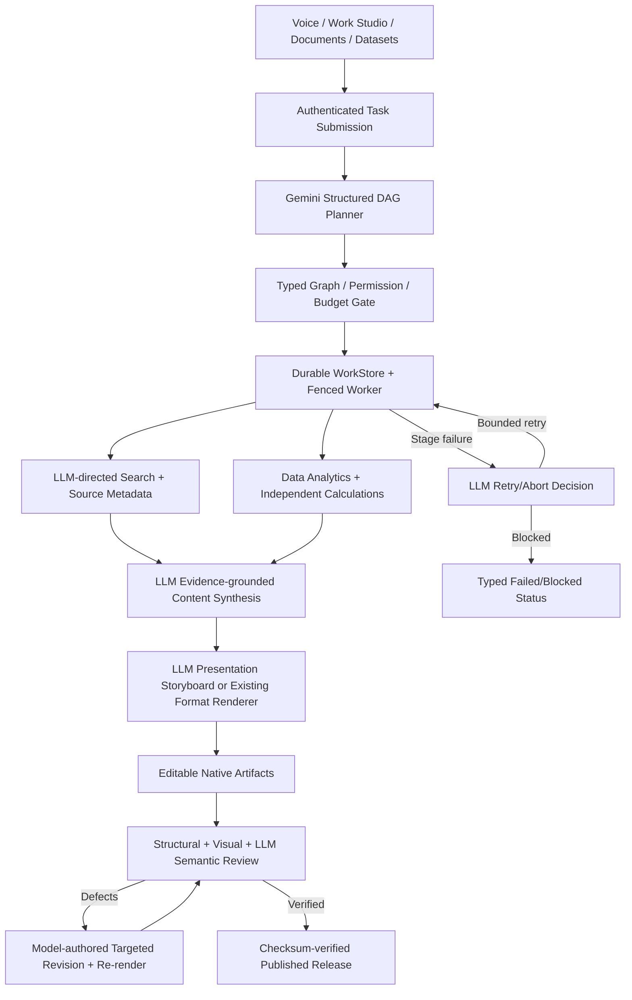

# Rizzler V15 — Cognitive Work Intelligence Architecture

> Status: **implementation branch / draft PR**. The first cognitive workflow slice is implemented but has not passed a provider-backed end-to-end release benchmark. This is not a claim that every type of artifact is supported or that any LLM can guarantee perfect accuracy.

## Design invariant

**Models own cognitive decisions and qualitative feedback; the runtime owns safety and facts of execution.**

LLM decisions: intent understanding, task decomposition, specialist selection, search questions, continuation/stop decisions, effort, content strategy, slide layout, error-recovery advice, semantic review and content repair.

Code-enforced invariants: authentication, ownership, permission approval, model schema validation, DAG acyclicity, source provenance labels, file validity, numeric calculation, independent formula verification, bounding/timeouts, cost budgeting, isolation, checkpoints, checksums and publication gates. Deterministic checking is not keyword routing or a substitute for model reasoning.

## Implemented in V15 branch

- `work_cognition.py`: typed Gemini structured decisions, model-authored research directions, independent artifact semantic critique, model-selected bounded retry/abort decisions and privacy-safe error classification.
- `work_worker.py`: iterated, model-directed, source-grounded research queries instead of two fixed queries; evidence-based research completeness status and error categorization. Research context preserved in synthesis.
- `work_specialists.py`: model-authored storyboard selection for PPTX in agentic mode; specialist retry requested from LLM but fenced and budgeted by WorkStore.
- `work_presentation.py`: editable widescreen native PowerPoint rendered from a validated Gemini storyboard. Supports covers, sections, bullets, two columns, metrics, comparisons, quotes, closing, source slides, and a chart when a real uploaded table supports the model-selected columns. Speaker notes and approved source hyperlink constraints included.
- `work_repair.py`: independent LLM completeness feedback in agentic QA, actionable defects passed into existing bounded repair; PPTX revisions use V15 storyboard path rather than reverting to old prose-to-slide renderer.
- `tests/test_v15_cognitive.py`: adversarial decision/schema tests, missing-grounding tests, research-to-synthesis test, native deck tests, model retry/abort ledger tests.
- Legacy V14 API, voice, auth, protected tool execution, approved formats and jobs remain operational on a separate branch.

### Important current limitations

1. Verified research *attribution* still does not independently verify every third-party page or numeric claim. `research_evidence.py` correctly labels this.
2. PowerPoint storyboards are LLM-authored, but their native shapes and quality bounds are produced/checked by Python. That is intentional.
3. Existing DOCX/PDF/XLSX/HTML/PNG/SVG skill renderers are **not yet rewritten** to use separate model-authored format-specific IRs. Some rely on legacy narrative sections and dataset inputs.
4. Independent semantic QA is a model judgment, not objective factual proof. It complements hard QA.
5. Large multi-source relational analytics, React UI migration, executable code artifacts and independent official-source crawling remain future work.
6. The platform cannot guarantee success for arbitrary requests or external outages; it must report supported limitations truthfully.
7. Full Gemini-grounded search, app authorization and actual production-rendered 16–22-slide quality have not been demonstrated in this branch.

## Execution topology

## Proposed specialist skill contracts

Every skill should be versioned, sandboxed and objectively testable. The model selects which skill to use; it cannot invent one.

| Category | Planned capability | Review contract |
|---|---|---|
| Research | Source discovery, protected page retrieval, change tracking, official datasets | Citation to primary-source location, freshness and contradiction report |
| Extraction | PDF, Office, image, table, code and diagram intelligence | Bounded extraction with page/cell/line provenance |
| Analytics | Multi-input profiling, join, SQL, finance, economics and statistics | Reproducible operation log, independent numerical reconciliation |
| Content | Editorial narrative, technical documentation and specifications | Completeness against original request, explicit limits |
| Presentations | SlideSpec/StorySpec, editable native layouts, chart design and speaker notes | Actual rendered slide inspection and grounded chart data |
| Documents | DocumentSpec, styles, footnotes, page-aware layout and PDF | OOXML/PDF validation, layout/readability and citations |
| Spreadsheets | WorkbookSpec, formulas, charts, scenarios and validation | Formula recomputation and source/assumption partitioning |
| Dashboards | Typed data models, interactive charts and filters | Browser functional tests against data and authenticated API |
| Code / Apps | Repo analysis, coding, tests and builds in isolated workers | Build/test/security evidence, no unapproved external writes |
| Visuals | Native charts, diagrams and generated images using appropriate providers | Provenance, captioning, user permissions and fidelity checks |
| Release | Multi-format packaging, signed metadata and lineage | All requested outputs exist and independent integrity gate passes |
| Recovery | Stage/claim diagnosis, LLM-directed correction and bounded retries | Idempotent fenced checkpointing and no false completion |

## Target Work Studio

React + TypeScript + Vite, TanStack Query for server state, React Flow for DAG inspection, ECharts for analytics, Monaco for code, Tiptap for editorial editing, PDF.js for rendered pages and Playwright for browser acceptance tests. Do not replace V14's voice transport before native Live remains fully functional in regression tests. Use the existing FastAPI authentication/session boundary and Work API.

UX: left projects rail; main user goal and current artifact; collapsible real agent DAG and evidence; editable native previews; source/calculation/QA drawer; voice/chat composer anchored to the same session. No giant always-visible debug console.

## Operational protections

- Durable owner-scoped job and event ledger, file SHA-256, fenced worker and checkpoint reuse.
- Schema constrained LLM decisions; no unapproved arbitrary shell commands.
- Per-stage retry budget (initial target: at most 1 model-approved additional attempt), and no retries of permission, exhausted budget or stale lease errors.
- Source texts and model output are untrusted; evidence/citations never authorize external actions.
- A failed model decision must not cause silent keyword or hardcoded workflow substitution.
- Monetary and provider budgets with explicit retry categories and separately measured real provider costs.
- No assertion of source truth simply from a Google-grounding URL.

## Quality rubric and planned qualification

Qualify separately for: (1) structural validity, (2) numerical/factual support, (3) completion relative to the original user request, (4) visual/readability/accessibility, (5) interactive functionality, (6) job recovery under simulated faults, (7) security/isolation, and (8) latency and model cost.

Suggested benchmark corpus: stakeholder financial deck; current-date grounded research; five-document technical synthesis; scanned PDF research; relational multi-source workbook; investor model with scenarios; responsive dashboard; React application; architecture diagram; legal memo; budget workbook; 16–22-slide PPTX; interrupted parallel job; grounding outage; provider 429; stale source; corrupted artifact; invalid model JSON; source prompt injection; user permission-denied request.

Each fixture has frozen source material, expected invariant checks, qualitative review criteria and testable deliverables. Report per-format success rates, critical defects, costs, p50/p95 stage latency and human-rated visual scores. Never report illustrative percentages as measured benchmarks.

## Release gates

1. Offline Python 3.11/3.12/3.13 app tests, JS checks, manifest and security checks all pass.
2. Real Gemini grounded search exercised against a dated official topic without invented citations.
3. Real research → synthesis → editable PPTX → visual/semantic QA → verified artifact release works from one authenticated Work job.
4. Model-directed retries are exercised under injected provider and renderer failures with correct durable states.
5. Manual stakeholder design review is performed on representative 16–22-slide outputs.
6. Later skill implementations are not claimed completed until their independent artifact test suites pass.

## Configuration

- `GEMINI_API_KEY`: provider credential kept server-side.
- `RIZZLER_AGENTIC_ENABLED=1`: model-authored DAG.
- `RIZZLER_ARTIFACT_QA=agentic`: model-assisted visual and semantic QA.
- `RIZZLER_V15_PRESENTATION=1`: activate LLM-generated storyboards for PPTX.
- `RIZZLER_V15_COGNITIVE_QA=1`: independent model critique.
- `RIZZLER_V15_RECOVERY=1`: allow model-supervised bounded retries.
- `RIZZLER_WORK_MODEL_TIMEOUT=65`: provider request budget subject to host restrictions.

If the V15 feature flags are unset, the branch auto-selects them for agentic jobs when a Gemini key is available; set them explicitly for predictable test and deployment behavior. Legacy paths remain for compatibility and offline testing.
