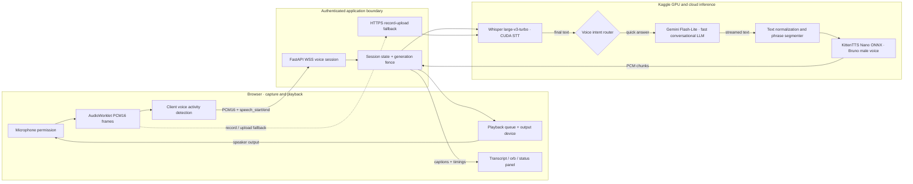
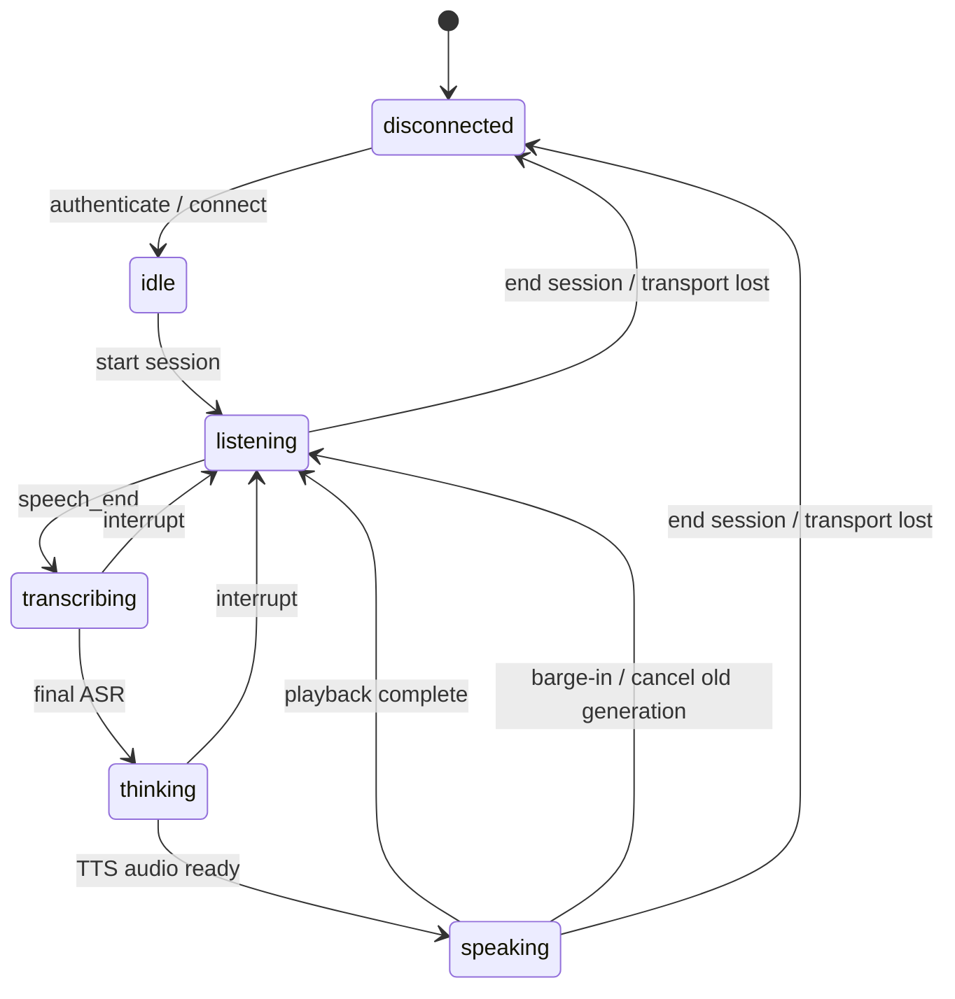

# Voice AI pipeline — architecture and execution trace

**Classification:** GPU-backed research / product showcase. The runnable implementation is currently a single Kaggle notebook with an embedded FastAPI server and browser frontend; the independently tested `src/rizzler/` contracts are an extraction target, not a fully integrated microservice deployment.

## System block diagram



**Inference and hardware details:** Whisper uses CUDA CTranslate2 when compatible and can fall back to PyTorch CUDA. KittenTTS is an ONNX runtime path; running on a CUDA machine does *not* prove that TTS itself runs on the GPU. Gemini runs as a cloud API, not on Kaggle GPUs. The browser sends PCM frames; Gemini API keys stay server-side and are loaded from Kaggle Secrets.

## End-to-end sequence

```mermaid
sequenceDiagram
  autonumber
  participant U as User
  participant B as Browser + AudioWorklet
  participant S as FastAPI session
  participant A as Whisper STT
  participant G as Gemini voice model
  participant T as KittenTTS
  U->>B: Start session (permission and audio unlock)
  B->>S: Authenticated WSS and audio configuration
  S-->>B: Session ready
  U->>B: Speak
  B->>S: PCM16 frames and VAD onset/end
  S->>A: Final utterance (with pre-roll)
  A-->>S: Final transcript
  S-->>B: Transcript update
  S->>G: Request + bounded conversation context
  G-->>S: Visible text deltas
  S->>T: Safe, grammatical speech chunks
  T-->>S: Synthesized PCM
  S-->>B: Speech chunks + response generation ID
  B-->>U: Audible reply (and transcript)
  opt User interrupts while speaking
    U->>B: New speech
    B->>B: Stop/clear old playback queue
    B->>S: Interrupt; advance generation ID
    S->>S: Cancel old work; reject stale frames
  end
```

## What is genuinely asynchronous?

- **Browser / server:** microphone PCM capture and response playback can run concurrently over the live WebSocket path. A fallback HTTP upload returns a complete response; it is **not** equivalent to real-time full duplex.
- **Text / speech:** visible Gemini text is segmented for TTS; first phrases may be synthesized while subsequent text arrives. TTS is not guaranteed to have stable low first-PCM latency.
- **Barge-in:** the client stops buffered audio and changes the active generation; the server cancels outstanding model/TTS coroutines and fences late frames. Native GPU kernels may not stop instantaneously.
- **Live captions:** interim ASR is provisional. The final transcript is produced after endpoint detection. Not every audio frame has a word-level caption.

## Session state machine



## Latency measurement: definitions and current evidence

| Boundary | Instrument | Actual V9 live result |
|---|---|---|
| Last user speech → VAD endpoint | browser PCM / VAD events | **Not recorded** |
| VAD endpoint → final transcript | server span | **Not recorded** |
| Gemini request → first visible text | SDK client span | **No current V9 benchmark** |
| First phrase → TTS PCM | speech worker span | **Not recorded** |
| Server first PCM → browser audible playback | server + browser timestamps | **Not recorded** |
| Speech onset during answer → old playback stopped | browser performance timestamps | **Not recorded** |

Historical 20-call Gemini first-text latency was **median 1012.7 ms, p95 1136.0 ms**. A separate 10-call persistent-client test reported **median 960.3 ms, p95 1076.3 ms**. These are earlier API-only observations, *not* V9 end-to-end performance claims. The 300 ms first-audio target is aspirational; see [benchmarks/RESULTS.md](../benchmarks/RESULTS.md).

## Failure and fallback behavior

| Failure | Intended handling | Limitation |
|---|---|---|
| WebSocket blocked by network | Use authenticated HTTPS record/upload | Not continuous full duplex |
| Empty microphone input | Reject blank utterance, show capture/volume diagnosis | Device permissions vary |
| VAD fails to close utterance | Utterance timeout and reset | Needs hardware/device coverage |
| Gemini timeout or 503 | Bounded retry / fallback model plan | Adds latency; quota/account-dependent |
| Old TTS PCM arrives after barge-in | Generation fence rejects obsolete output | Native compute may continue briefly |
| Browser disconnected | Reconnect session; preserve bounded local history | Kaggle runtime/storage can be lost |

## Production boundaries still missing

OAuth-based identity, managed Redis/PostgreSQL, durable work queues, S3-compatible artifacts, distributed inference workers, device-specific AEC tuning, production HTTPS ingress, tracing and SLO dashboards, automated GPU/browser testing, and security testing. The Kaggle notebook is a demo environment and cannot guarantee uptime.
