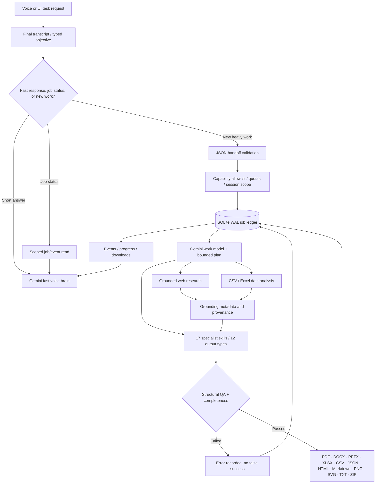

# Gemini Work Agent — asynchronous task and deliverable architecture

**Goal:** separate a low-latency conversational assistant from bounded, longer-running tasks. Both use server-side Gemini credentials; the Work Agent can use a separate model configuration and tool policy.

## Job execution contract

The versioned handoff envelope includes `objective`, `session_id`, `context`, `allowed_tools`, `requested_formats`, `limits`, and task metadata. Validate on the server rather than trusting a model-produced list. The session scope determines which uploads, job records and artifact downloads may be accessed. The agent is **not** permitted to execute arbitrary shell commands or call undeclared external services.

| State | Meaning | Allowed transition |
|---|---|---|
| queued | Validated, waiting for available worker | running / cancelled |
| running | Model planning or approved tool execution | completed / failed / cancelling |
| cancelling | User requested termination | cancelled / failed |
| completed | Required artifacts verified and indexed | terminal |
| failed | Missing deliverable, tool error, budget, or validation failure | terminal (manual new job) |
| cancelled | Cooperative cancellation acknowledged | terminal |

Status comes from **stored events**, not invented natural-language percentages. An answer can say “research complete; generating slides” only if those stage events exist. A finished ZIP includes SHA-256 entries for output integrity.

## Deliverable production boundary

- **Research:** grounded sources and limits; automated factual reliability is not a substitute for human verification.
- **Analytics:** dataset provenance, missingness, descriptive statistics, aggregation and correlation; no unsupported financial forecasts or causal inference.
- **Reports (PDF, DOCX, HTML, Markdown):** typography, sections, source notes and format-specific layout rules.
- **Slides (PPTX):** editable 16:9 layouts, meaningful hierarchy, structured insights and source notes; human visual QA for overlap/legibility.
- **Workbooks and data (XLSX, CSV, JSON):** data, formulas, charts and quality sheets with structural checks; recalc and stress testing outstanding.
- **Visualizations (PNG, SVG):** numeric charts only when actual dataset values are provided; fail rather than invent data.
- **Automations:** explicit approval before recurring work; schedules run only while the server is active. This is **not** a managed 24×7 scheduler.

## Operational and security limitations

A Kaggle notebook is a single-process demo. SQLite/WAL and local files are not durable across notebook resets; tool execution depends on Gemini credentials, network and API quotas. Real product deployment needs durable queue/DB, object storage, authentication, rate limits, audit retention, document malware scanning, citation QA and end-to-end load tests. The Work Agent still requires live Gemini task evaluation.
